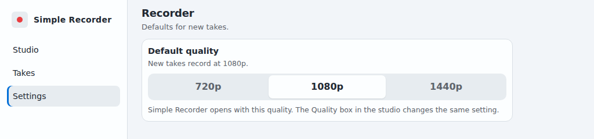

# Simple Recorder

A free, open source screen recorder for **Windows** (Windows 10 and 11). Record the whole screen, one window, or an area you draw, with or without your microphone. Takes are saved as MP4. No account, no watermark, no time limit.

[](https://github.com/Josephivgi/simple-recorder/releases/latest/download/SimpleRecorder-Setup.exe)

The button downloads `SimpleRecorder-Setup.exe`, always the newest version. Older versions and release notes are on the [Releases page](https://github.com/Josephivgi/simple-recorder/releases).


## What it does

- **A floating recorder bar** that stays on top of every window: Record, pause, stop, start delay, frame rate, sound, and what to record, all in one strip.
- **Record what you want:** the screen under your pointer, a window you pick, or an area you drag.
- **Your choice of quality:** 720p, 1080p, or 1440p at 24, 30, or 60 frames per second.
- **Microphone** with a level meter and a test button, or record silently.
- **Start delay** (3, 5, or 10 seconds) and **auto stop** (5, 15, or 30 minutes).
- **Stop from anywhere** with `Ctrl+Shift+Alt+S` while a take is rolling.
- **Takes page:** every recording grouped by the day it was made, with a preview and buttons to open it, show it in its folder, or delete it.
- **Default quality** in Settings, so every new take starts at the height you want.
- **Updates in one click.**


## Install on Windows

You don't need administrator rights. Simple Recorder installs for your Windows user only.

**1. Download.** Click **Download for Windows** above to get `SimpleRecorder-Setup.exe`.

**2. Run it.** Open `SimpleRecorder-Setup.exe` from your browser's downloads or your Downloads folder.

**3. If Windows warns you.** Windows may show **Windows protected your PC**, because the app is not signed by a known publisher. Click **More info**, then **Run anyway**.


**4. Wait a few seconds.** The setup installs Simple Recorder, adds it to the Start Menu and your desktop, and opens it.


That's it. Open Simple Recorder from the Start Menu or the desktop shortcut from now on. You can delete `SimpleRecorder-Setup.exe`.

## Updates

Simple Recorder checks for a new version when it starts and every 15 minutes. When one is out, the **Updates** box in the bottom left says **New update detected**. Click **Download** and the app restarts on the new version. You never need to download the setup again.


Every update is checked against the SHA-256 published with its release before anything is installed. Releases are only published after an automated security gate passes (secret scanning, dependency audit, unit tests, and a scan of the update package itself).

Updates never touch your recordings or your settings.

## Settings

Open **Settings** to pick the **Default quality** for new takes: 720p, 1080p (the default), or 1440p. It is the same setting as the Quality box in the studio, and it is remembered when you close the app.



## Report a problem

Open **Settings** and click **Report a bug** or **Suggest a feature**. Your browser opens a new [GitHub issue](https://github.com/Josephivgi/simple-recorder/issues) with the app version and Windows version filled in. Nothing is sent until you post it, and posting needs a free GitHub account. Please report security problems [privately](https://github.com/Josephivgi/simple-recorder/security/advisories/new) instead.

## Privacy

Simple Recorder has no account, no analytics, and no telemetry. The only thing it sends over the network is the update check, an anonymous request to this repository's GitHub Releases. Recordings stay on your computer.

## Uninstall

Open **Settings > Apps**, find **Simple Recorder**, and choose **Uninstall**. Your recordings are kept.

## Where your files are

| What | Folder |
| --- | --- |
| Recordings, one folder per day | `Videos\Simple recorder` |
| The app | `%LOCALAPPDATA%\Programs\Simple Recorder` |
| Settings and logs | `%APPDATA%\Simple Recorder` |

## For developers

Simple Recorder is an Electron app with no runtime dependencies beyond Electron itself. Settings live in SQLite (`node:sqlite`).

```
npm install
npm start        # run from source
npm test         # unit tests
npm run smoke    # hidden boot check
npm run gate     # the release security gate
```

A copy run from a source checkout never updates itself. Each release carries `SimpleRecorder-Setup.exe` (built with NSIS from `scripts/installer.nsi`) plus `simple-recorder-<tag>-app.tar.gz` and `latest.json` for the in-app updater, built and published by `.github/workflows/release.yml` once the gate passes. See `AGENTS.md` for the full layout.

Bug reports and ideas are welcome in [Issues](https://github.com/Josephivgi/simple-recorder/issues).

## License

[MIT](LICENSE)
