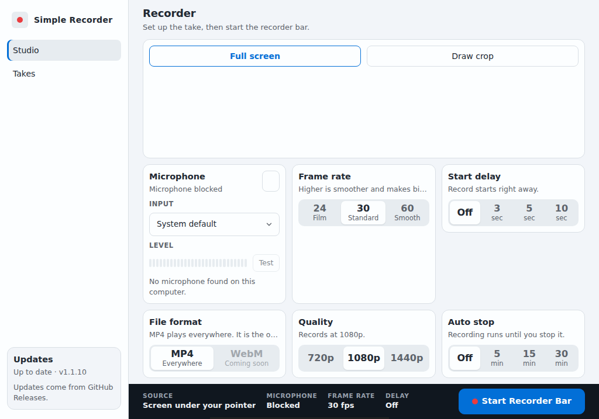
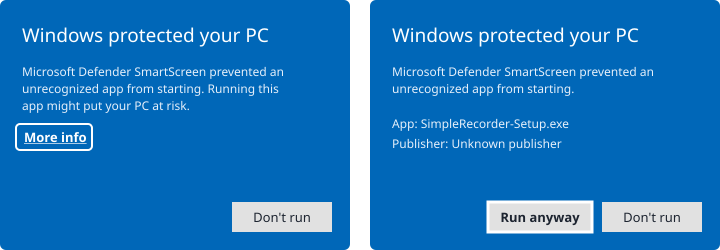
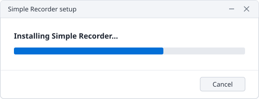
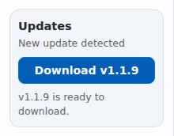

# Simple Recorder

A screen recorder for **Windows** (Windows 10 and 11). Record the whole screen, one window, or an area you draw, with or without your microphone. Takes are saved as MP4.

[](https://github.com/Josephivgi/simple-recorder/releases/latest/download/SimpleRecorder-Setup.exe)

The button downloads `SimpleRecorder-Setup.exe`, always the newest version. Older versions and release notes are on the [Releases page](https://github.com/Josephivgi/simple-recorder/releases).



## Install on Windows

You don't need administrator rights. Simple Recorder installs for your Windows user only.

**1. Download.** Click **Download for Windows** above to get `SimpleRecorder-Setup.exe`.

**2. Run it.** Open `SimpleRecorder-Setup.exe` from your browser's downloads or your Downloads folder.

**3. If Windows warns you.** Windows may show **Windows protected your PC**, because the app is not signed by a known publisher. Click **More info**, then **Run anyway**.



**4. Wait a few seconds.** The setup installs Simple Recorder, adds it to the Start Menu and your desktop, and opens it.



That's it. Open Simple Recorder from the Start Menu or the desktop shortcut from now on. You can delete `SimpleRecorder-Setup.exe`.

## Updates

Simple Recorder checks for a new version when it starts and every 15 minutes. When one is out, the **Updates** box in the bottom left says **New update detected**. Click **Download** and the app restarts on the new version. You never need to download the setup again.



## Uninstall

Open **Settings > Apps**, find **Simple Recorder**, and choose **Uninstall**. Your recordings are kept.

## Where your files are

| What | Folder |
| --- | --- |
| Recordings, one folder per day | `Videos\Simple recorder` |
| The app | `%LOCALAPPDATA%\Programs\Simple Recorder` |
| Settings and logs | `%APPDATA%\Simple Recorder` |

## For developers

```
npm install
npm start        # run from source
npm test         # unit tests
npm run smoke    # hidden boot check
```

Every push to `main` builds and publishes a GitHub Release (`.github/workflows/release.yml`). Each release carries `SimpleRecorder-Setup.exe` (built with NSIS from `scripts/installer.nsi`) for people to download, and `simple-recorder-<tag>-app.tar.gz` plus `latest.json` for the in-app updater. A copy run from a source checkout never updates itself. See `AGENTS.md` for the full layout.
